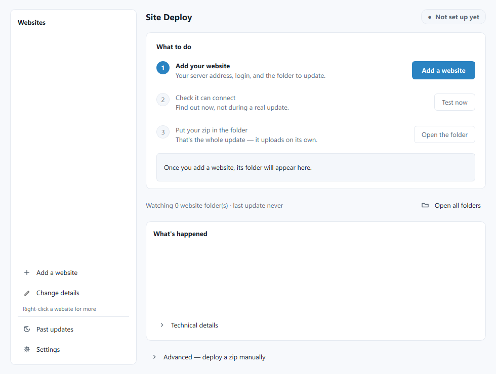
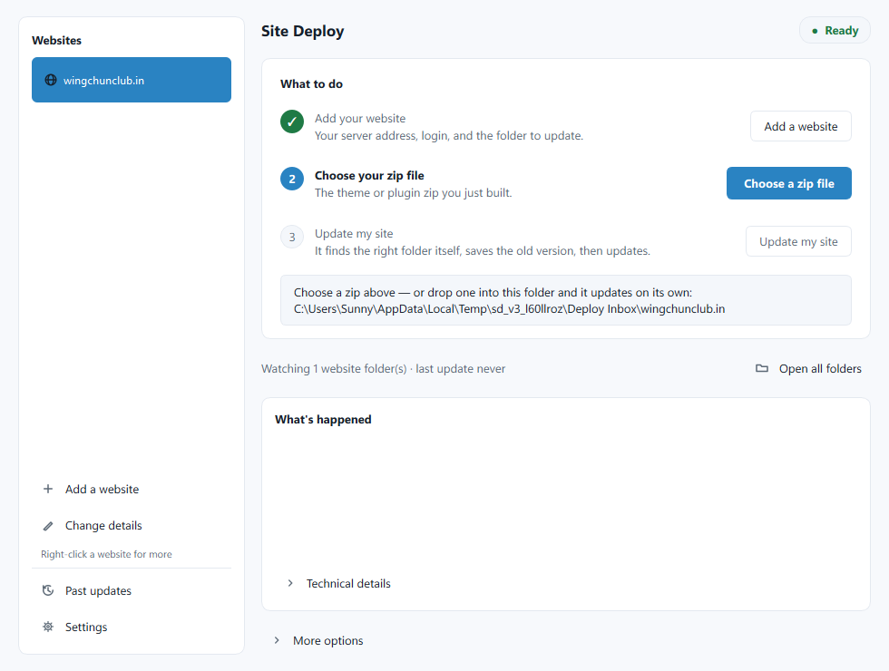
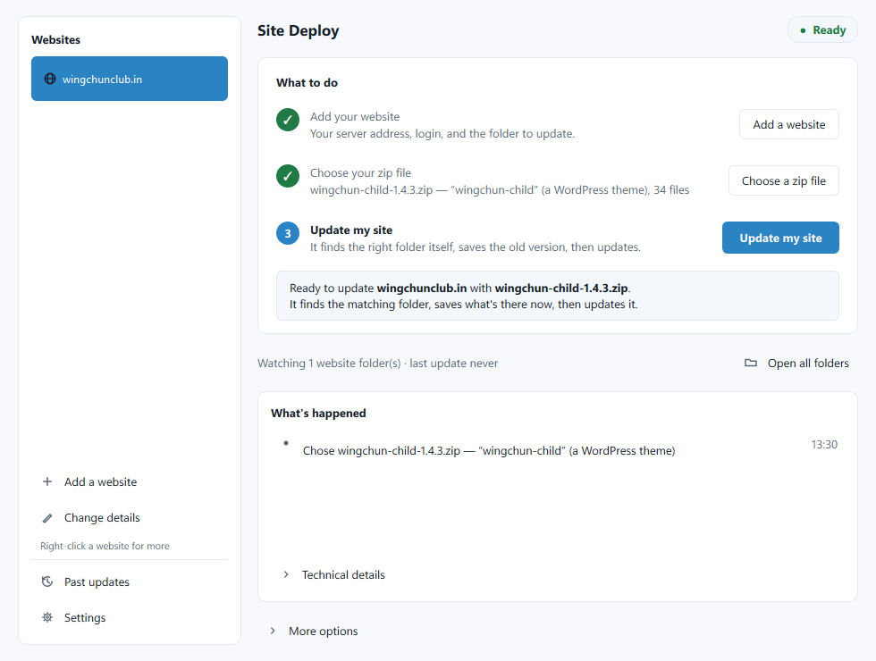
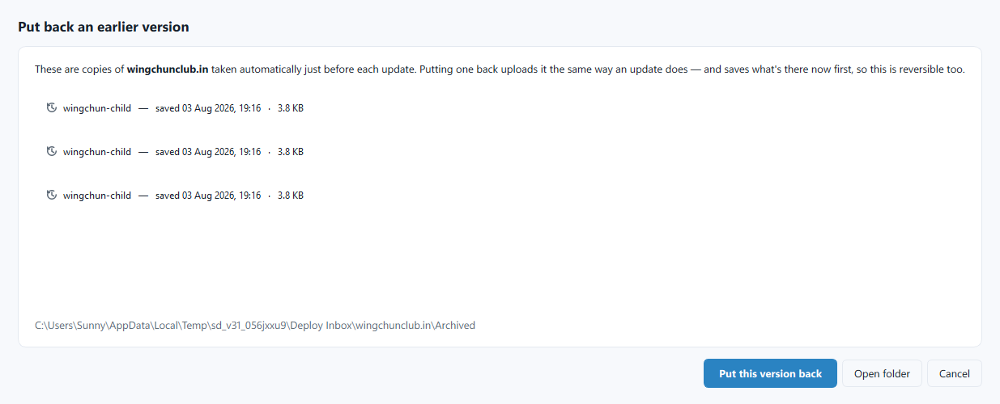
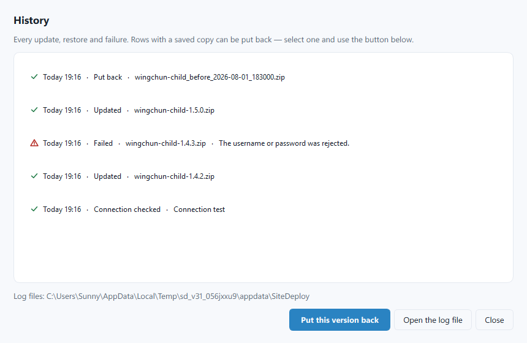

# Site Deploy

A Windows tray app for pushing website updates without touching a File
Manager or FTP client. Drop a zip or a single file, it figures out where
that file goes on your live WordPress site, backs up what's there first,
and uploads the new version — with a one-click rollback if something
looks wrong. Built it after one too many manual FTP uploads to my own
client sites.



v4.3.0 — updates your website from a zip file *or* a single file (a .php,
.css, .js, image, whatever your site needs), has a Plugins screen to
view/install/delete plugins, and only ever runs one copy at a time. No
Hostinger login, no File Manager, no WP admin upload, and no working out
where files go.

## The whole routine

1. Build your theme/plugin zip, or just have the one file you changed —
   like `pa-site.php` for parikharch.com.
2. **Choose what to upload** in Site Deploy — a zip package or a single
   file. You can also just **drag it onto the window**.
3. **Update my site.** It finds the matching place on your site (a folder
   for a zip, the existing file's location for a single file), saves a
   copy of what's there now, and puts the new version in. If it's
   something new, it creates the folder or asks you where a lone file
   should go.

Or drop the file into the website's folder
(`Desktop\claude code\Deploy Inbox\<your site>\`) and the same thing
happens on its own — Site Deploy sits in the system tray watching.

## Drag and drop

- **A zip or file to upload** — drop it anywhere on the window, same as
  choosing it in step 2.
- **A text file with FTP/SFTP details** — save Hostinger's (or any host's)
  connection details to a `.txt`/`.md`/`.ini`/`.cfg`/`.conf`/`.log` file
  and drop it, or just select and drag the text itself from an email or
  panel. Works either labeled ("Host:", "Username:", "Password:") or as a
  plain template — one value per line, nothing else on the line, in any
  order (e.g. site name / address / port / username / password). Address
  is recognized by shape (`ftp://...` or a bare domain/IP); a bare number
  becomes the port. It **pre-fills the Add Website dialog** — nothing is
  ever saved until you check it and press Save. A file that doesn't read
  like connection details is treated as a normal upload instead, and a
  note in the activity list says so.
- **"Import website from a file..."** in the sidebar — for when you want
  to be explicit rather than drop-and-hope: point it at any file and it's
  read as login details directly. If nothing recognizable turns up, it
  tells you plainly instead of guessing.
- **Several websites in one note** — a list of sites' details, one after
  another (blank lines between them or not), is split correctly per site
  rather than mixing fields from different sites together. If more than
  one is recognized, a picker lets you choose which to add — each one
  still opens its own confirm-and-save step.
- **Multiple files at once = a queue** — drop more than one file together
  (zips, single files, any mix) and they update the currently selected
  website one after another automatically, each still showing its own
  "here's where this goes" confirmation first. Drop just one file and
  it's staged for you to press Update my site, same as always.

## How it knows where files go

**Zip packages** — a **theme** (`Theme Name:` in style.css) goes to
`wp-content/themes`, a **plugin** (`Plugin Name:`) to `wp-content/plugins`.
It finds your WordPress install by looking for `wp-content`.
- **Similar names are treated as updates.** `wingchun-child-1.4.3`,
  `wingchun_child` and `WingChun-Child-2.0` all update the existing
  `wingchun-child` — version numbers and `v2`/`-final`/`(1)` endings are
  ignored. It tells you what it matched and why.
- **No match means new**, and it creates the folder.

**Single files** — it looks for a file of that exact name already on your
site: inside a matching plugin folder first, then every theme and plugin
folder, then the folder saved in the website's details. Whichever place
already has that filename is where the replacement goes.
- **If nothing matches**, it suggests a folder and lets you either accept
  it or **browse the server and pick the real folder** yourself.

Either way, it always asks once, showing the exact destination, before
changing anything.

## Your old version is kept

Before replacing anything, what's currently there is downloaded into:

`Deploy Inbox\<your site>\Archived\<name>_before_<date>.zip`

— the whole folder for a zip update, or just that one file for a
single-file update, along with a small note recording exactly where it
came from. That copy lives **on your PC, not the website** — so it can
never show up in WordPress or get switched on by accident. To put it
back, use **Put back a version** in the sidebar or **History** — it goes
to the exact same spot automatically.

## First-time setup

1. Run Site Deploy. On first run the window opens (nothing configured yet).
2. **Add a website** — pick **which host it's on** first for a hint on
   where to find your FTP details (exact steps for Hostinger; general
   guidance for others), then enter the server address, username and
   password — or drop in a text file/pasted text with those details and
   let it pre-fill the form for you. The folder on the server is a
   starting hint only; Site Deploy works out the real destination from
   what you upload. Adding a website creates its drop folder automatically.
3. Your username and password go straight into **Windows Credential
   Manager** — the same protected vault Windows and browsers use for
   saved logins. `%APPDATA%\SiteDeploy\profiles.json` never holds the
   secret at all, not even encrypted — only a reference to the vault
   entry. Nothing about it is readable on another PC or by another user.
4. Choose your zip or file and press **Update my site**. It shows you the
   destination it found and asks before changing anything.
5. Close the window whenever you like — it keeps running in the tray.

Find your credentials in Hostinger: hPanel → your website → **Files → FTP
Accounts** (FTP/FTPS) or **Advanced → SSH Access** (SFTP).




## The window

- **What to do** — three numbered steps: add your website, choose what to
  upload, update my site. The one you're on is highlighted; done ones get
  a green tick.
- **Status**, top right: Not set up yet / Ready / Updating your site /
  Needs a look.
- **What's happened** — one line per step with an icon (connected →
  uploading → live). Raw output and error traces sit behind *Technical
  details*.
- **Put back a version** and **History** in the sidebar.
- **More options** — test the connection, open the drop folder, open the
  saved copies.
- **Appearance** in Settings: Light (default), Dark, or Match Windows.

## Tray menu

- **Open Site Deploy** — the full window.
- **Open Inbox** — the drop folders.
- **Pause watching** — stop auto-deploying without quitting.
- **History** / **Settings**.
- **Clear error state** — acknowledge a failed deploy (appears only when
  there's something to clear).
- **Quit**.

## What happens on a drop

- The file must stop growing for ~2 seconds before it's touched, so a
  file still being copied is never half-deployed.
- A zip is extracted; if it's wrapped in a single top-level folder (the
  normal WordPress theme/plugin shape) that wrapper is unwrapped, so the
  contents land directly in your server folder — same result as
  WordPress's "Replace current with uploaded". A single file is uploaded
  as itself.
- **Success:** toast (with the version if the filename has one), the file
  moved to `Deployed\2026-08-02_143000_yourtheme-1.4.2.zip`.
- **Failure:** a toast that sticks around for a minute, *and* the tray
  icon turns red and stays red until you acknowledge it. The file stays in
  the inbox and won't be retried until you change it. Details are in the
  activity log and in the history file.

## Settings

- **Watching on/off**, **Deploy Inbox location**, and **Start with
  Windows** (off by default — turn it on if you want it running after a
  reboot without launching it yourself).
- Per-website: an auto-deploy checkbox, if you want one site to stay
  manual-only.

## Plugins

**Plugins** in the sidebar connects to your website and lists everything
in `wp-content/plugins`, with the name and version read from each one.

- **Install a plugin** — pick a zip or a single file, same as the main
  "Choose what to upload" step. It goes to the right place using the same
  folder matching the rest of the app uses.
- **Delete a plugin** — backs it up first (into the same place as
  everything else, restorable from History), then removes it from the
  server.

**What this can't do:** tell you whether a plugin is switched on, or turn
one on or off. That's stored in your website's database, not in its
files — FTP/SFTP, which is how Site Deploy talks to your server, has no
way to see or change it. **Deleting an active plugin's files can break
your site** until you deactivate it in WordPress admin or restore the
backup — Site Deploy warns about this every time, since it genuinely
can't check for you.

## Putting a version back



**Put back a version** in the sidebar lists every copy saved before an
update — date, size, newest first — and puts the one you choose back.
You can also select any row in **History** that has a saved copy and press
*Put this version back*.

A rollback goes through the same steps as an update, so **what it replaces
is saved too** — you can undo the undo.

## History



Every update, creation, restore, connection check and failure is recorded:
what happened, the folder it went to, and the saved copy that goes with it.
Hover a row for the full detail. Files live in `%APPDATA%\SiteDeploy\` —
`history.log` (readable) and `history.jsonl` (structured).

## Connection types

- **Automatic — secure if the server allows it (recommended).** Tries an
  encrypted connection first and falls back to plain FTP only if the server
  refuses, saying so in the activity list.
- **Secure FTP (also called FTPS)** / **Plain FTP — NOT secure** — force
  one or the other.
- **Secure SSH transfer (also called SFTP)** — if Hostinger gave you SSH
  credentials (hPanel → Advanced → SSH Access), port 22.

If a connection ends up unencrypted, Site Deploy says so in the activity
list and tells you which setting to change.

## Rebuilding

```bash
python -m PyInstaller --onefile --windowed --icon "C:/Users/Sunny/Desktop/claude code/15 - site-deploy/icon.ico" --name "SiteDeploy" --distpath dist --workpath build --specpath build main.py
"C:\Program Files (x86)\Inno Setup 6\ISCC.exe" installer.iss
```

Outputs go to `../portable/15 - Site Deploy Portable.exe` and
`../executable/15 - Site Deploy.exe` per the standard build convention.

## Known limits

- **Files removed from your theme aren't deleted on the server.** An
  update overwrites and adds; it doesn't prune. If you delete a file from
  the theme, it stays on the site until you remove it yourself.
- **The backup downloads every file** in the target folder before
  updating, so a large theme takes a moment on a slow connection. That's
  the price of being able to roll back.
- The backup lives on this PC only. If you move to another PC, copy the
  `Archived` folders across too.
- Very large folders are capped at 4,000 files per backup.
